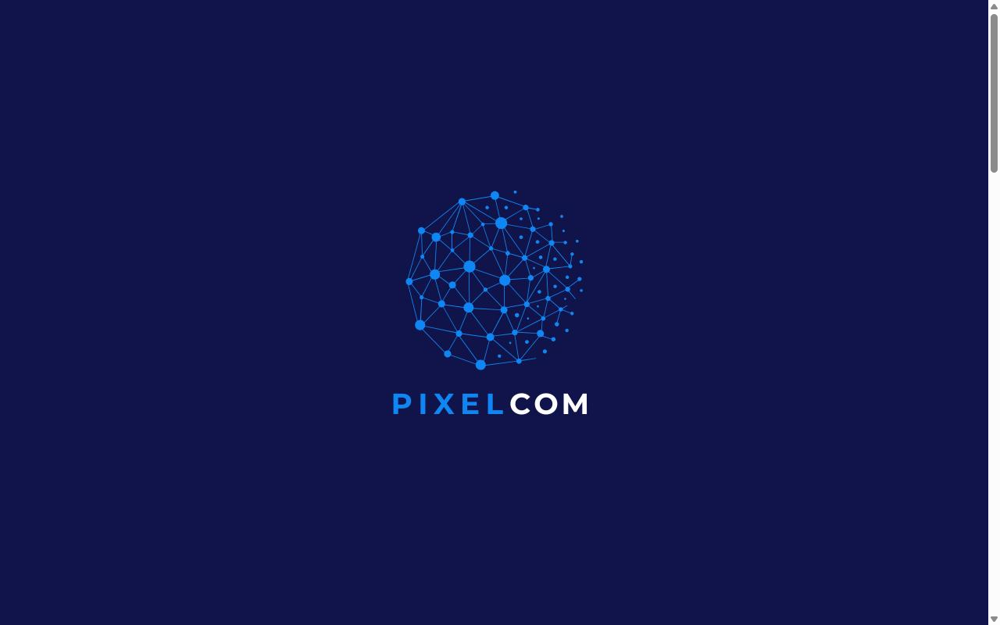

# PixelCom — Site Vitrine Agence Web & SEO

  
  
  
  

  

 

Site vitrine moderne et responsive conçu pour une agence digitale spécialisée dans la création de sites web sur-mesure, l'optimisation SEO et la maintenance applicative.

---

## Démo en Ligne

Le site est hébergé sur GitHub Pages :  
**[https://nedjaryanis.github.io/pixelcom/](https://nedjaryanis.github.io/pixelcom/)**

---

## Fonctionnalités Principales

- **Design Moderne & Épuré** : Palette chromatique professionnelle, typographie soignée et mise en page responsive fluide.
- **Section Services Détaillée** : Présentation claire des prestations (Conception Web, Référencement Naturel / SEO, Audit & Stratégie).
- **Catalogue de Réalisations** : Galerie visuelle de projets récents avec filtres interactifs.
- **Formulaire de Contact Dynamique** : Zone d'échange et demande de devis ergonomique.

---

## Technologies Utilisées

- **HTML5 Sémantique** : Structure conforme aux standards W3C et accessibilité web.
- **CSS3 Avancé** : Flexbox, CSS Grid, animations douces et Media Queries pour tous terminaux (mobile, tablette, desktop).
- **JavaScript ES6+** : Interactions dynamiques, gestion des événements et validation côté client.

---

## Auteur

Projet conçu et développé par **[Yanis Nedjar](https://github.com/NedjarYanis)**.
